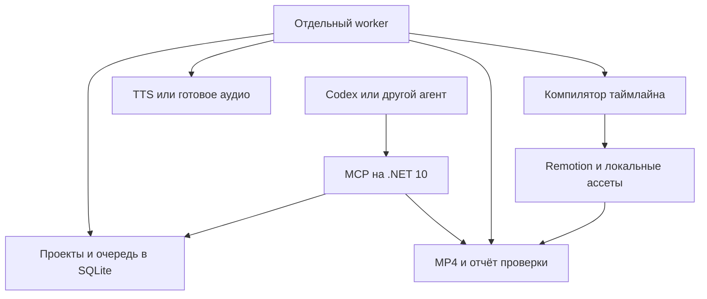

# Техническое задание для Codex на создание Toon MCP

Версия 1.0. Дата: 26 октября 2026 года. Язык продукта и примеров: русский.

## 1. Задача и ожидаемый результат

Создать локальный MCP-сервер и движок производства коротких вертикальных 2D мультроликов. Пользователь описывает идею в Codex или другом совместимом агенте; агент выбирает стиль, персонажей и сцены, формирует структурированный проект и вызывает инструменты MCP. Система сохраняет проект, получает озвучку, рассчитывает таймлайн, анимирует персонажей, добавляет субтитры и собирает готовый MP4.

Первый прикладной сценарий — рекламные и объясняющие ролики для Telegram-бота «Новостройкин» (@novostroykin_bot): два персонажа обсуждают поиск квартиры, один показывает бота на телефоне. Продукт отслеживает новые проекты, корпуса, квартиры, снятие брони и изменения цен в Москве и Санкт-Петербурге. Не добавлять неподтверждённые обещания о доходности, гарантированной скорости уведомлений, ценах или количестве пользователей.

Основной продукт — повторно используемая библиотека персонажей, движений и постановочных правил, управляемая через MCP. Codex составляет сценарий и данные сцен; стабильный рендерер исполняет их. Для очередного ролика не требуется генерировать заново приложение React или исполнять произвольный код из пользовательского запроса.

**Результат разработки:** запускаемый репозиторий, работающий MCP, отдельный worker, рендерер Remotion, оригинальный пакет одного визуального стиля, автономный демонстрационный проект, интеграция ElevenLabs, документация и доказательства прохождения критериев приёмки. Этот комплект файлов является ТЗ и контрактами для разработки, а не реализованным MCP.

### Принятые допущения

- Первая версия предназначена для одного владельца и запуска на его компьютере или Linux-сервере.
- Управляющая часть и worker — C# / .NET 10; рендерер — TypeScript / React / Remotion.
- MCP использует stdio. Удалённый многопользовательский сервис относится к следующей версии.
- Целевое окружение первой приёмки — Linux x64 или WSL2. Поддержка macOS возможна, но подтверждается отдельным запуском, а не заявляется автоматически.
- Пользователь предоставляет свой ключ ElevenLabs и выбирает доступные ему голоса. Дополнительно поддерживаются готовые аудиозаписи без облачного синтеза.
- Плановая длина ролика — 20–45 секунд; жёсткий предел финального таймлайна MVP — 60 секунд.

Обычные технические решения принимать самостоятельно в пределах ТЗ. Вопрос пользователю необходим только для данных, которые нельзя безопасно получить или выбрать: конкретный аккаунт/голос, отсутствующие реальные скриншоты, существенное изменение назначения продукта.

## 2. Основание и изученные референсы

Изучены присланный скриншот профиля codil.ya, публичное описание технологии на сайте автора и последовательности кадров трёх открытых видеопримеров со страницы стиля «МУЛЬТИК»:

| Пример | Длительность скачанного примера | Наблюдаемые решения |
| --- | --- | --- |
| «Алкаш просит приложение на миллион» | около 91,6 с | Переключение между человеком и персонажем на экране; накопление предметов и карточек; реакции и изменение крупности |
| «Алкаш предлагает сайт» | около 53,6 с | Телефонный разговор; крупные планы лица и телефона; смена собеседника; эмоциональные позы |
| «Алкаш на встрече выпускников» | около 52,4 с | Групповая сцена; реакции второстепенных героев; предмет на переднем плане; отдельная вставка экрана телефона |

У проверенных файлов разрешение 720×1280, частота 30 кадров/с, видео H.264 и аудио AAC. Это свойства изученных примеров, а не ограничение будущей системы. Анализ основан на кадрах и метаданных; качество голосов и точность артикуляции на слух отдельно не оценивались. Все публикации Instagram не просматривались.

На сайте автора подтверждён процесс: агент получает через MCP инструкции и материалы стиля, собирает сцены и звук, рендерит в Remotion, проверяет результат и сохраняет проект [1, 2]. По кадрам видны тёмный контур, бумажная фактура, повторяющийся герой, ограниченная анимация, монтаж по репликам, реквизит и короткие подписи с цветовым акцентом.

**Вывод для нашей реализации:** качество должно обеспечиваться согласованными персонажами, постановкой, темпом и возможностью точечных правок. Один вызов text-to-video не является обязательной частью MVP. Создавать собственные компоненты, рисунки, фоны, тексты и звуки; исследовательские копии чужих видео и код витрины в продукт не включать.

## 3. Границы первой версии

### Обязательная функциональность

1. Один оригинальный визуальный стиль рисованного 2D мультфильма.
2. Два постоянных персонажа с различимыми внешностью и голосовыми назначениями.
3. Две локации: ресторан и домашний кабинет; дополнительный нейтральный фон для экрана и CTA.
4. Общий план, крупный план каждого героя и вставка экрана телефона.
5. Эмоции, моргание, движение головы, простые жесты, показ телефона и реакция собеседника.
6. Диалоги на русском, загрузка записанных реплик, синтез через один TTS-провайдер.
7. Короткие субтитры; подсветка слов при наличии корректных таймингов.
8. Необязательная музыка и эффекты из зарегистрированных локальных файлов.
9. Предпросмотр и финальный MP4, обложка, JSON проекта, рассчитанный таймлайн, субтитры и отчёт проверки.
10. Редактирование проекта с ревизиями; повторное использование уже полученной озвучки.
11. Асинхронный запуск, статус, отмена, восстановление достоверного состояния после сбоев.
12. Автономный пример без API-ключей после установки зависимостей.

### Следующие версии

Расширяемые сторонние пакеты стилей, дополнительные TTS-провайдеры, фонемная артикуляция, сложная ходьба и взаимодействия, генерация новых рисунков через image API, веб-редактор, Streamable HTTP с авторизацией, несколько пользователей, облачный рендер и публикация в соцсети. В MVP оставить точки расширения без реализации этих подсистем.

## 4. Архитектура



Диаграмма показывает зависимости компонентов. Worker опрашивает очередь; MCP не держит соединение открытым на время всего рендера.

| Компонент | Обязанности |
| --- | --- |
| Toon.Mcp | MCP tools/resources, проверка входов, операции над проектом, постановка job, чтение статуса |
| Toon.Core | Доменные модели, семантическая валидация, работа с ревизиями, вычисление ключей кеша |
| Toon.Worker | Очередь, аренда задания, TTS, подготовка таймлайна, запуск рендерера, отмена и проверка результата |
| Toon.Infrastructure | SQLite, файловое хранилище, адаптер ElevenLabs, запуск внешних процессов |
| renderer | Стабильные React/SVG компоненты, кадры, обложки, preview и MP4 |
| style packs | Манифесты, оригинальные персонажи, фоны, жесты, шрифты, правила постановки |

Использовать официальный C# SDK MCP [3]. Конкретные совместимые стабильные версии NuGet/npm проверить при реализации, зафиксировать lock-файлами и записать в README. Не подставлять предполагаемые номера версий из памяти. Не реализовывать JSON-RPC вручную, когда это делает SDK.

SQLite достаточно для одного владельца и одного активного render job. Использовать миграции, WAL, короткие транзакции, busy timeout и атомарное получение lease. Redis, брокер сообщений и Kubernetes для MVP не требуются.

Worker запускается отдельной документированной командой и не является дочерним процессом MCP. Закрытие сессии Codex не должно останавливать уже принятый рендер. Если worker не запущен, `studio_doctor` явно показывает это; `start_render` сообщает, что задача поставлена в очередь, и не создаёт видимость активной обработки.

## 5. Данные проекта и источник истины

Входной контракт — `contracts/project.schema.json`, DraftProject версии 1.0.0. Пример — `examples/novostroykin.project.json`. JSON Schema проверяет форму; семантические проверки описаны в `contracts/README-contracts.md` и ниже.

### DraftProject

Хранит стиль и его версию, seed, формат, персонажей и версии их моделей, сцены, реплики, эмоции, жесты, камеру, ссылки на ассеты, настройки субтитров и звука. Секреты, абсолютные пути, бинарные изображения, произвольные сетевые URL и исполняемый код в проект не входят.

Проект содержит намерения: например, показать телефон на начале реплики. Точные моменты определяет компиляция после получения аудио. Плановую длительность использовать как редакционную цель, а не как основание обрезать запись.

Сцены воспроизводятся последовательно. В диалоговой сцене одновременно звучит одна реплика. Перекрытие голосов не входит в MVP. Паузы задаются в миллисекундах. События привязываются к началу или окончанию реплики либо к границе слова с нулевым индексом; правила индексации и нормализации зафиксированы в контракте.

### CompiledTimeline

Внутренний производный документ с собственной версией схемы. Обязательные поля: project_id, revision, schema_version, renderer_version, fps, width, height, total_frames, ссылки на аудио и его фактическую длительность, размещение каждой реплики, камеры, жестов, субтитров и эффектов.

Все интервалы кадров — `[start_frame, end_frame_exclusive)`: начало включается, конец исключается. Абсолютные границы визуальных событий округлять к ближайшему кадру, midpoint away from zero; соседние интервалы используют одну вычисленную границу. Времена аудио сохранять также в отсчётах или микросекундах, чтобы округление кадров не накапливало ошибку. Только итоговую длину округлять вверх до полного кадра. Аудио не ускорять и не обрезать для попадания в target.

Одинаковая ревизия с теми же аудиофайлами, версиями ассетов и seed должна давать одинаковый таймлайн. Побайтовое совпадение MP4 между платформами не является критерием.

### Ревизии

Каждое успешное изменение создаёт новую неизменяемую ревизию. `update_project` принимает полную замену DraftProject и `expected_revision`; частичные JSON Patch операции в MVP не нужны. При конфликте возвращать `REVISION_CONFLICT`, не перезаписывая чужое изменение. Job всегда ссылается на конкретную ревизию и снимок разрешённых версий ассетов и голосов.

Разговор с агентом не заменяет сохранённый проект: после новой MCP-сессии проект можно прочитать, изменить и пересобрать.

## 6. Ассеты и пакет стиля

Каждый ассет имеет `asset_id`, неизменяемую версию, тип, MIME, SHA-256, размер, относительное расположение в хранилище и сведения о происхождении. При импорте ассет копируется; последующее изменение исходного файла не меняет существующую версию. Для аудио сохраняются длительность, частота и число каналов; для изображения — размеры.

Персонажи — готовые многослойные модели, а не набор случайно сгенерированных портретов. Подробные требования к слоям, точкам вращения, эмоциям, жестам и рту находятся в `ANIMATION-AND-QA.md`. Рендерер должен выдавать ошибку отсутствующего слоя или неподдерживаемого жеста до дорогостоящего этапа.

Пакет стиля содержит `manifest.json`, оригинальные компоненты/ассеты и `DIRECTING.md`. Минимальный пакет `warm_editorial_2d@1.0.0` должен разрешать все ID из примера: герои buyer/advisor, поза seated, эмоции concerned/neutral/surprised/pleased, жесты shrug/show_phone, фоны restaurant_evening/neutral_dark, presets high_contrast_ru/hook/cta. Дополнительно поставить фон home_office и остальные действия из ANIMATION-AND-QA. В руководстве описать: форму короткой истории, допустимые планы, выбор жестов, чередование говорящего и реакции, правила использования телефона, размещение текста и минимум движения в каждой сцене. Агент должен получать руководство через каталог или MCP resource, чтобы качество не зависело от памяти прошлой беседы.

Для MVP импортировать PNG/JPEG для изображений и WAV/MP3 для аудио. Для аудио `register_asset` может дополнительно принять `alignment_path`: JSON по `contracts/audio-alignment.schema.json` либо SRT с фразовыми таймкодами. Sidecar читается из тех же разрешённых корней, проверяется и становится неизменяемыми метаданными импортированного asset. SRT не является word alignment. Пользовательские SVG/HTML/JS и архивы не выполнять. Собственные SVG-компоненты входят в доверенный рендерер. Базовые ограничения импорта: 25 MiB на media-файл, 1 MiB на sidecar, 12 миллионов пикселей на изображение, 120 секунд на аудио; параметры настраиваемые.

Реальные скриншоты бота вставлять как исходные изображения. Не перерисовывать надписи генеративной моделью и не создавать вымышленные уведомления под видом реального интерфейса. В данном пакете нет исходных скриншотов интерфейса бота: пример содержит логические ссылки, которые нужно заменить зарегистрированными ассетами. Скриншот профиля codil.ya для демонстрации бота не использовать.

## 7. Контракты MCP tools

Все имена ниже — интерфейс нашего приложения, а не встроенные методы протокола. Для каждого tool задать понятные description, inputSchema и, где поддерживается SDK, outputSchema. Пользовательские ошибки передавать через tool result с `isError`, устойчивым кодом и описанием; не использовать исключения без содержательного сообщения. Протокольные ошибки оставлять SDK.

Общий успешный результат содержит `ok: true` и `data`. Ошибка: `ok: false`, `error: { code, message, retryable, details }`. Размещать этот discriminated union в `structuredContent`; в `content` добавлять компактную текстовую JSON-копию для совместимости, а ссылки на артефакты — отдельными resource_link. OutputSchema каждого tool описывает обе ветви. `isError=true` означает неисполненный tool вызов. Успешный `get_job`, вернувший job со state=failed, имеет `ok=true` и `isError=false`: ошибка относится к job, а опрос выполнен корректно. `details` может содержать JSON Pointer, известную текущую ревизию и рекомендуемое действие. Секреты и сырой ответ провайдера туда не включать. Логи и сообщения subprocess не загрязняют MCP stdout [4, 5].

| Tool | Обязательные входы | Результат и поведение |
| --- | --- | --- |
| `studio_doctor` | нет | Версии зависимостей, доступность renderer/FFmpeg/fonts, состояние worker, готовность голосовых alias; без значений ключей |
| `get_catalog` | `kind` | Версионированные styles, characters, backgrounds, gestures, voices; при необходимости cursor/limit; короткие превью и guide resource |
| `register_asset` | `source_path`, `kind`; для аудио необязателен `alignment_path` | Проверка разрешённого пути и содержимого, неизменяемая копия, asset_id/version/hash и метаданные |
| `create_project` | `project` | Валидный DraftProject, project_id, revision=1, список предупреждений; отсутствующие внешние зависимости могут сохраняться как draft |
| `get_project` | `project_id`; revision необязательна | Запрошенная либо последняя ревизия, readiness и ссылки на последние jobs |
| `update_project` | `project_id`, `expected_revision`, `project` | Полная замена данных с новой ревизией или REVISION_CONFLICT |
| `validate_project` | `project_id`, `revision` | Ошибки/предупреждения, пригодность к рендеру, зависимости, оценка объёма нового TTS; без платных вызовов |
| `start_render` | `project_id`, `revision`, `quality`, `idempotency_key` | Быстро возвращает job_id, state и poll_after_ms; quality=preview/final; фиксирует render snapshot |
| `get_job` | `job_id` | state, stage, progress либо null, timestamps, ошибки, подтверждённый и неопределённый объём TTS, готовые artifact IDs |
| `cancel_job` | `job_id` | Идемпотентный запрос отмены; cancelling до фактической остановки либо неизменённое терминальное состояние |
| `get_artifacts` | `job_id` | Проверенные выходные файлы, MIME, размер, hash, длительность, resource URI и доступное локальному клиенту расположение |

`start_render` дополнительно принимает `allow_new_tts` (по умолчанию false) и `max_new_tts_characters` в пределах серверного лимита. При allow_new_tts=true числовой лимит обязателен; при false он равен 0. Это явное разрешение оплачиваемой операции в приложении. Агент использует ранее разрешённый пользователем режим и не требует повторных подтверждений для каждого слова или сцены. В режиме false разрешены записи и уже имеющийся кеш; при недостатке данных возвращать `TTS_REQUIRED` до постановки платной работы.

`validate_project` возвращает `estimated_new_tts_characters` и `estimated_new_tts_requests`: объём ещё не закешированного текста, рассчитанный до отправки. Для собственного лимита считать Unicode code points фактически отправляемого нормализованного текста, включая пробелы; provider billing units могут отличаться. Денежная оценка относится только к этим TTS-запросам и допустима при известном актуальном тарифе; иначе `estimated_cost: null`, `currency: null` и объяснение. Работа Codex, рендер и лицензии в эту оценку не входят. После выполнения отдельно показывать подтверждённый provider usage и запросы с неизвестным результатом; не выдавать оценку за списание. Для MVP можно по умолчанию ограничить новый TTS 4000 символами на job; лимит документировать и сделать конфигурируемым.

### Пример запуска

```json
{
  "project_id": "project_example",
  "revision": 3,
  "quality": "preview",
  "idempotency_key": "project-example-r3-preview-001",
  "allow_new_tts": false,
  "max_new_tts_characters": 0
}
```

Пример показывает форму вызова после создания реального проекта. Идентификатор `project_example` не является существующим объектом.

### Resources

Предусмотреть `toon://styles/{id}/{version}/guide`, `toon://projects/{id}/revisions/{revision}` и `toon://jobs/{id}/report`. Текстовые resources отдавать через `resources/read`. Основные данные доступны и через tools, чтобы работа не зависела от того, как конкретный клиент показывает resources.

Большие видео не вкладывать base64 в ответы модели. Использовать метаданные, `resource_link` и путь к реальному файлу. В локальном stdio клиент и сервер работают в одной файловой среде. Для будущего remote transport понадобится доступный клиенту authenticated download endpoint; путь на удалённом диске сам по себе не решает скачивание.

## 8. Очередь и жизненный цикл задания

Состояния: `queued`, `running`, `cancelling`, `succeeded`, `failed`, `cancelled`. Этапы running: `preflight`, `speech`, `timing`, `render`, `encode`, `verify`. Не использовать один процент для принципиально неизмеримых стадий: возвращать stage и null либо честный прогресс текущего этапа.

Запись job хранит project_id/revision, хеш снимка, quality, idempotency_key, state/stage, время создания/начала/окончания, heartbeat, lease_until, attempt, параметры разрешённых расходов и ссылки на артефакты. Для всех persisted timestamps использовать UTC.

- Один активный job на worker в MVP. Остальные остаются queued.
- `start_render` с тем же ключом и тем же нормализованным запросом возвращает уже созданный job. С тем же ключом и другим содержимым — `IDEMPOTENCY_CONFLICT`.
- Worker получает job транзакционно. Длительные операции не выполняются внутри транзакции SQLite.
- Heartbeat по умолчанию каждые 5 секунд; срок lease 30 секунд, значения настраиваемые.
- После утраты worker и истечения lease recovery переводит job в failed с `WORKER_INTERRUPTED`. Полное продолжение с произвольного кадра не обещать. Новый запуск использует сохранённые аудио и промежуточные данные, если они прошли проверку.
- При закрытии MCP worker продолжает job. При остановке worker незавершённый MP4 не считается готовым.
- Отмена queued немедленна. Для running — cancelling, затем остановка контролируемого дерева процессов и cancelled. Истёкший lease для cancelling завершается как cancelled; временные результаты не публикуются.
- `succeeded` возможен только после проверки MP4 и атомарной публикации набора выходных метаданных. Файл `.partial` не выдавать как результат.

Отмена и финальная публикация синхронизируются транзакционно: если уже опубликовано succeeded, отмена сообщает терминальное состояние; если принят cancelling, завершившийся encode не может позднее переопределить его как succeeded.

MCP call не должен ждать минутный рендер и не требует искусственного 30-минутного timeout. Базовая совместимость достигается `start_render/get_job/cancel_job`. Нативное расширение MCP Tasks добавляется отдельно только после проверки capabilities клиента; оно не заменяет устойчивую очередь.

## 9. Озвучка и расчёт таймлайна

Базовый облачный адаптер — ElevenLabs. Использовать доступную текущую модель с русским языком; наличие требуемого голоса проверять по аккаунту. Сохранить provider/model/version настроек и реальные параметры запросов. Подтверждённый endpoint with-timestamps возвращает аудио и посимвольные временные метки [7].

Порядок выполнения:

1. Проверить структуру, ссылки, голоса, поддерживаемые движения и лимиты.
2. Найти записанные реплики и пригодный кеш TTS.
3. Оценить новые вызовы, применить разрешение и лимиты.
4. Получить недостающее аудио; проверить декодирование и сохранить атомарно.
5. Измерить фактическую длительность; подготовить слова, captions и огибающую громкости.
6. Скомпилировать сцены, паузы, события и total_frames.
7. Проверить максимум 60 секунд. Если превышен — `DURATION_LIMIT_EXCEEDED` с фактической длиной и рекомендацией сократить реплики. Не терять уже полученное аудио.
8. Отрендерить и проверить результат.

Соответствие текста таймингам обязательно. У провайдера может быть нормализованный текст, например произнесённые числительные. Сохранять display text, spoken/normalized text и карту соответствия. Не назначать индекс слова автоматически, если надёжного соответствия нет: вернуть ошибку привязки или использовать явно выбранный режим captions по целой реплике.

Посимвольные метки не являются фонемами или готовыми формами рта. В MVP сделать 3–4 состояния рта по огибающей громкости, закрытие на тишине и привязку к активному говорящему. Режим называется approximate/amplitude, не «точный lip-sync». Полная артикуляция вынесена за рамки первой версии.

Для записей поддержать sidecar alignment с явной provenance и привязкой через register_asset. `captions.mode` обязателен: auto использует word timing при наличии проверенного alignment и целую реплику при его отсутствии; word без alignment возвращает ALIGNMENT_UNAVAILABLE; utterance всегда показывает целую реплику. Word anchors требуют alignment независимо от режима captions. Длинную реплику без таймингов не делить на придуманные временные отрезки: если она не помещается в разрешённые две строки, вернуть CAPTION_OVERFLOW и предложить сократить текст либо предоставить разметку. Финальный режим amplitude mouth вместе с целой репликой допустим. Запись должна соответствовать указанной реплике; автоматическая проверка смыслового совпадения не считается решённой одним ffprobe, речевые fixtures проверяются прослушиванием.

### Кеш и неопределённый ответ провайдера

Ключ кеша включает текст, нормализацию, provider, model, resolved voice ID, фактически применённый delivery, голосовые параметры, словарь произношения, формат аудио и версию адаптера. Alias сам по себе не является достаточным ключом. В MVP каждая реплика синтезируется независимо, без previous_text/next_text и request stitching: правка одной реплики не инвалидирует соседние. Если в будущем появится такой контекст, включить его в ключ и явно пересмотреть область инвалидирования. Изменение только камеры или caption preset не вызывает новый TTS.

Для одной комбинации параметров обеспечить single-flight, чтобы два job не синтезировали её одновременно. Новые запросы журналировать до отправки. При 429 учитывать Retry-After; при временных ошибках использовать ограниченные повторы, только когда их семантика не создаёт скрытых дубликатов.

Если соединение оборвалось после отправки и неизвестно, списал ли провайдер средства, использовать `PROVIDER_OUTCOME_UNKNOWN`. Сначала попытаться восстановить результат по поддерживаемой истории/request ID. Если это невозможно, не повторять платную операцию молча: job останавливается с ясным статусом. Exactly-once выполнение во внешнем API не обещать без его поддержки.

## 10. Рендер и визуальные требования

Полные требования находятся в `ANIMATION-AND-QA.md`. Обязательные значения:

| Параметр | Значение MVP |
| --- | --- |
| Финальный формат | 1080×1920, 9:16, 30 fps |
| Предпросмотр | 540×960, 30 fps; тот же таймлайн и аудио |
| Контейнер | MP4, H.264, yuv420p, AAC 48 kHz, faststart |
| Длина | Цель 20–45 с, максимум 60 с |
| Размещение текста | Прямоугольник x=80…900, y=180…1580 в координатах 1080×1920 |
| Субтитры | До двух строк, целевой кегль 44–64 px, минимум 36 px; переполнение — ошибка/переразбиение |
| Аудио | Для обычного речевого ролика целевой уровень −16 LUFS ±1 и true peak не выше −1 dBTP |

Зоны текста и аудиопараметры — проектные настройки, а не обещание соответствия всем интерфейсам и требованиям Instagram. Проверять реальный просмотр на телефоне.

Remotion принимает JSON inputProps и параметры композиции для программного рендера [6]. Анимация вычисляется от кадра через `useCurrentFrame()` и детерминированные функции; не зависит от часов системы, сетевых ответов, `Math.random()` без seed, CSS-анимаций реального времени или `setTimeout` [8].

Рендерить только после загрузки локальных шрифтов и ассетов. Случайность зерна бумаги и моргания должна быть стабильной, без раздражающего мерцания. Текст, рамка телефона и руки не пересекают лицо или интерфейс, если это не явно заданный художественный приём.

Музыка выключена, пока пользователь не предоставил подходящий asset. При её наличии реализовать приглушение под речью; итог проверять на слух. Не скачивать случайный трек и не использовать музыку из референсов.

## 11. Хранение и выходные материалы

Всё состояние находится под настраиваемым `TOON_DATA_ROOT`. Импорт читается только из `TOON_IMPORT_ROOTS`; эти значения задаются пользователем/оператором и не изменяются самим tool вызовом.

| Область | Содержимое |
| --- | --- |
| database | Проекты, ревизии, jobs, provider requests, реестр ассетов |
| assets | Неизменяемые копии импортированных материалов по hash/version |
| audio-cache | Аудио, alignment, измерения и ключ кеша |
| projects | Сохранённые DraftProject, compiled timelines и экспортируемые manifest |
| jobs | Временные файлы и логи конкретного запуска |
| artifacts | Только проверенные выходные материалы |

Каждый успешный job выдаёт: MP4, PNG-обложку, сохранённую ревизию проекта, compiled timeline JSON, captions JSON/SRT и validation report JSON. Каждый final-job дополнительно автоматически создаёт переносимый ZIP проекта с manifest зависимостей, хешами, версиями и разрешёнными ассетами; архив доступен через get_artifacts, отдельный export tool не нужен. Секреты в экспорт не включать; voice aliases перечислять как требующие локальной настройки.

Сохранять проектную связь результата: artifact_id → job_id → project_id + revision. Не перезаписывать готовый ролик новым заданием под тем же именем. Экспорт проекта в архив должен быть переносимым с включёнными разрешёнными ассетами и относительными путями; доступ к облачным голосам на другой машине требует её собственных настроек.

## 12. Конфигурация и обработка ошибок

Документировать `TOON_DATA_ROOT`, `TOON_IMPORT_ROOTS`, параметры worker, concurrency=1, лимиты размера/длительности, лимиты TTS, пути к Node/FFmpeg и конфигурацию voice aliases. `ELEVENLABS_API_KEY` читать из окружения или явно подключённого секретного хранилища. Пример `.env.example` содержит только пустые значения и названия переменных.

Голосовой alias описывает provider, доступный voice_id, model_id и настройки. Не назначать голос другого человека без выбора пользователя. Для автономных recorded fixtures облачный alias не требуется.

Минимальные коды ошибок: `VALIDATION_ERROR`, `PROJECT_NOT_FOUND`, `REVISION_CONFLICT`, `ASSET_MISSING`, `ASSET_VERSION_MISMATCH`, `VOICE_NOT_CONFIGURED`, `UNSUPPORTED_ACTION`, `AMBIGUOUS_CUE`, `ALIGNMENT_UNAVAILABLE`, `CAPTION_OVERFLOW`, `TTS_REQUIRED`, `TTS_LIMIT_EXCEEDED`, `PROVIDER_ERROR`, `PROVIDER_OUTCOME_UNKNOWN`, `DURATION_LIMIT_EXCEEDED`, `RENDER_FAILED`, `VERIFY_FAILED`, `WORKER_INTERRUPTED`, `IDEMPOTENCY_CONFLICT`, `CANCELLED`.

Проверять paths после canonicalization и разрешения symlink. Не разрешать traversal и выход из allowlisted roots. Запускать процессы через список аргументов без shell интерполяции. Не принимать от модели командные строки FFmpeg, `eval`, произвольный TSX или загружаемые скрипты.

По умолчанию renderer использует только подготовленные локальные ресурсы. Провайдер TTS — отдельный контролируемый сетевой доступ worker. Логи содержат идентификаторы, этапы, время и безопасные ошибки, но не ключи, auth headers и полный сырой ответ сервиса. Тексты реплик хранятся в проекте; необходимость дублировать их в логах отсутствует.

## 13. Структура репозитория и developer experience

| Путь | Назначение |
| --- | --- |
| `src/Toon.Mcp` | stdio host и инструменты |
| `src/Toon.Core` | Доменные модели и правила |
| `src/Toon.Infrastructure` | Persistence, TTS, внешние процессы |
| `src/Toon.Worker` | Durable worker |
| `renderer` | TypeScript/React/Remotion и CLI entrypoint |
| `styles/warm_editorial_2d` | Манифест и оригинальный визуальный пакет |
| `contracts` | DraftProject, timeline, job и artifact schemas |
| `examples/offline-dialogue` | Готовый автономный пример с легально включёнными записями |
| `examples/novostroykin` | Прикладной сценарий, заменяемые скриншоты и voice aliases |
| `tests` | Значимые unit, integration и визуальные проверки |
| `scripts` | Документированный setup, doctor, offline demo и acceptance |
| `docs` | Архитектура, форматы, подключение клиента, добавление стиля |

README должен позволять пройти путь от чистого окружения до MP4: проверить зависимости, установить пакеты и Chromium, собрать решение, запустить worker, подключить MCP, зарегистрировать ассеты, открыть пример, запустить preview, получить файлы. Команды подключения Codex сверить с установленной версией и её локальной справкой; не переносить конфиг другого клиента без проверки.

Предоставить `packages.lock.json` либо эквивалентное воспроизводимое закрепление NuGet и lock-файл npm. Зафиксировать рабочие версии runtime и браузера. Собрать один компактный `scripts/acceptance` entrypoint; он не должен автоматически запускать платные API-тесты.

Для assets/fonts/audio вести `THIRD_PARTY_NOTICES.md` и provenance manifest. Remotion имеет собственные лицензионные условия; применимость к выбранному использованию проверить по актуальной официальной странице [9]. Не называть весь стек безусловно бесплатным.

## 14. План реализации для Codex

### Этап 1. Один ролик по данным

Создать схему, оригинальные компоненты двух героев, фон, кадрозависимую анимацию и автономные аудиофайлы. Из JSON локально получить короткий MP4 с настоящими репликами и субтитрами. Сначала доказать визуальный и звуковой сквозной результат.

Если невозможно подготовить законно включаемые речевые fixtures без дополнительных данных, технические тоны разрешены для unit/integration тестов, но не засчитываются как завершённая речевая демонстрация. Чётко сообщить, какой именно критерий остаётся непроверенным; остальную реализацию продолжить.

### Этап 2. Хранение и worker

Добавить SQLite, ревизии, реестр ассетов, durable queue, отмену, кеш и atomic artifact publication. Проверить конфликт ревизий, повтор job, остановку и перезапуск.

### Этап 3. MCP

Реализовать перечисленные tools/resources поверх уже работающего ядра. Выполнить реальное MCP-подключение и сквозной offline сценарий. Одного `tools/list` недостаточно для объявления MCP готовым.

### Этап 4. Реальная облачная речь

Добавить ElevenLabs, таймкоды, voice aliases, расходные ограничения, journaling, кеш и обработку неоднозначного timeout. Без ключа проверить адаптер на контролируемых fixtures и указать, что живая интеграция не запускалась. С ключом и разрешённым объёмом выполнить отдельный live acceptance.

### Этап 5. Качество и прикладной пример

Довести лица, жесты, монтаж, captions, звук и phone insert. Собрать сценарий Новостройкина с настоящими скриншотами после их регистрации. Проверить полноразмерные ключевые кадры и прослушать ролик целиком.

На каждом этапе сохранять работающий вертикальный срез. Не заменять недостающую функциональность успешным mock ответом и не раздувать MVP веб-кабинетом, платежами или публикацией в соцсети.

## 15. Приёмка

Подробные требования к изображению, аудио и контрольным кадрам — в `ANIMATION-AND-QA.md`. Следующие проверки обязательны:

| ID | Сценарий | Ожидаемый результат |
| --- | --- | --- |
| A01 | Чистая установка по README | Зависимости определяются; документированные команды воспроизводимы |
| A02 | Offline demo через MCP после установки, без ключей и сети | MP4 с двумя узнаваемыми героями, настоящими репликами, субтитрами, несколькими планами и финальным кадром |
| A03 | Невалидная сцена/неизвестный жест/отсутствующий asset | Ошибка с JSON Pointer до платных операций |
| A04 | Создание и правка из новой MCP-сессии | Проект и ревизии не зависят от истории чата |
| A05 | Два update с одним expected_revision | Второй получает REVISION_CONFLICT, данные не теряются |
| A06 | Два одинаковых start_render с одним ключом | Один job; иной запрос с тем же ключом отклоняется |
| A07 | Изменение только камеры | Нового TTS нет; голоса и персонажи сохраняются |
| A08 | Изменение одной реплики | Меняются только необходимые аудио/тайминги; кеш остальных пригоден |
| A09 | Закрытие MCP при живом worker | Job продолжается и доступен после новой сессии |
| A10 | Аварийная остановка worker | Lease истекает; состояние достоверно; partial MP4 не публикуется |
| A11 | Отмена во время рендера | Дочерние процессы завершены; job не становится succeeded после отмены |
| A12 | Длинное аудио/предел 60 секунд | Речь не обрезается; превышение выдаёт понятную ошибку |
| A13 | Запись без word alignment | Нет выдуманных word timing; допустим whole-utterance caption, word anchors отклонены |
| A14 | Разрешённый TTS лимит превышен | Новые запросы не начинаются; сохранённый кеш не теряется |
| A15 | Неоднозначный timeout провайдера | Нет скрытого повторного платного вызова; PROVIDER_OUTCOME_UNKNOWN |
| A16 | Traversal/symlink и недопустимый импорт | Чужие файлы не читаются, команды не исполняются |
| A17 | Протокол и логи | stdout содержит только MCP; секреты отсутствуют в ответах и логах |
| A18 | Проверка результата | Полное декодирование MP4, правильные потоки/размер/fps, финальная реплика и последний кадр целы |
| A19 | Повтор одного проекта | Стабильный таймлайн и визуально одинаковые контрольные кадры в фиксированном окружении |
| A20 | Реальный скриншот телефона | Текст не изменён; масштаб и показ позволяют прочитать целевой элемент |
| A21 | Живой TTS тест при настроенных ключах | Реальные два голоса, тайминги, кеш и журнал расходов проверены; без ключа результат честно pending |

В итоговом отчёте Codex перечисляет: что реализовано; как запустить; где лежат MP4/проект; какие проверки пройдены; какие требуют голоса/скриншотов/ключа; известные ограничения. «Собирается код» и «возвращается job_id» не заменяют готового проверенного видео.

## 16. Расходы и эксплуатационные ограничения

Стоимость состоит из работы агента, новых реплик TTS, подготовки новых материалов, вычислений рендера, хранения и применимых лицензий. Не переносить цены или время отдельных маркетинговых тестов автора на эту реализацию.

Для повторных роликов переиспользуются персонажи, фоны и кеш аудио. Новые жесты, сложные взаимодействия и новые ракурсы требуют расширения пакета стиля. MCP сам по себе не обеспечивает художественное качество и не предсказывает просмотры.

До появления измерений не обещать определённую скорость рендера, требуемую видеокарту или стоимость ролика. В benchmark report записывать реальное окружение, длительность, время стадий, peak memory, размеры и cache hits. CPU-рендер допускается; необходимость GPU не вводить без измерений.

## 17. Источники

Ссылки проверены 26 октября 2026 года. Сведения об устройстве продукта автора отделены от наших проектных требований. Перед реализацией повторно проверить меняющиеся API и лицензии.

1. [codil.ya — как работает](https://codilya.ru/how-it-works): роли агента, MCP, материалов и Remotion.
2. [codil.ya — стиль МУЛЬТИК](https://codilya.ru/styles/multik) и [публичная витрина](https://codilya.ru/?section=mcp): примеры, описание стиля и заявленный процесс.
3. [Официальный C# MCP SDK](https://github.com/modelcontextprotocol/csharp-sdk): SDK для серверов и клиентов .NET.
4. [MCP stdio](https://modelcontextprotocol.io/specification/2026-07-28/basic/transports/stdio): жизненный цикл процесса, stdin/stdout/stderr.
5. [MCP tools](https://modelcontextprotocol.io/specification/2026-07-28/server/tools): инструменты, схемы и результаты.
6. [Remotion renderMedia](https://www.remotion.dev/docs/renderer/render-media): программный рендер, inputProps и параметры композиции.
7. [ElevenLabs speech with timing](https://elevenlabs.io/docs/api-reference/text-to-speech/convert-with-timestamps): аудио и посимвольное выравнивание.
8. [Remotion animation](https://www.remotion.dev/docs/animating-properties): управление анимацией через номер кадра.
9. [Remotion License and Pricing](https://www.remotion.dev/docs/license/pricing): условия использования.
10. [FFmpeg filters](https://ffmpeg.org/ffmpeg-filters.html): фильтры звука и видео; [FFprobe](https://ffmpeg.org/ffprobe.html): проверка метаданных.

